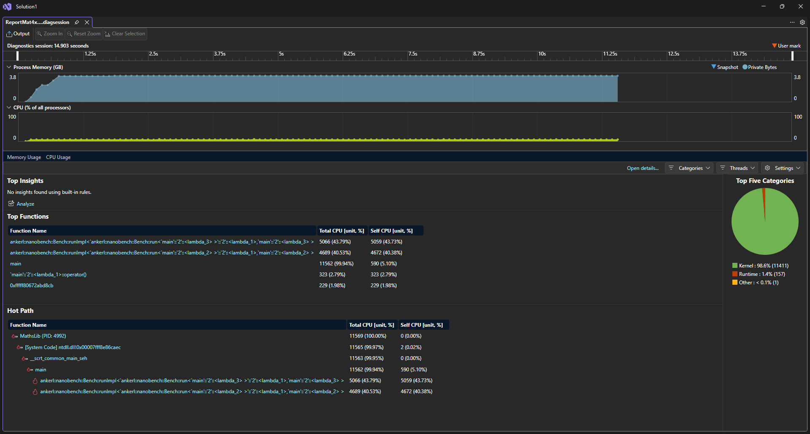

# Results can be found in "GC-PROJEKT-RED\GC_PROJEKT_RED\MathsLib\results"

CPU used for benchmark : AMD Ryzen 7 7700 8-Core Processor

SSE usable: true

AVX2 usable: true

FMA usable: true

Seed: 12345, vectors_per_batch (`count` in `main.cpp` at `l.99`) : 100 / 1 000 / 250 000 / 1 000 000 / 10 000 000

Epochs: 100
Warmup: 10
Batch : vectors_per_batch
Runs: 10, values below are medians of the 10 runs

Build: Release x64,std::c++20 ,/arch:AVX2
Compiler: MSVC, toolset v145

# Protocol v1 (commit 008e12c, 2026-10-08): SUPERSEDED, kept for comparison

SIMD and scalar vectors were filled with different random numbers. Dot was Dot(v, v) on ONE array.

-------------------------------------------------------------------------------------

`2026-10-08_21-21-44`

|           benchmark |               ns/op |     Min |       Max 
|--------------------:|--------------------:|--------:|-----------
|         `Normalize` |               1.845 |    1.66 |      2.01 
|     `CPP_Normalize` |               1.75  |    1.71 |      2.16 
|               `Dot` |               0.805 |     0.8 |       1.1 
|           `CPP_Dot` |               0.5   |    0.49 |      0.55 
|    `Mat4x4 * Vec4f` |               1.35  |    1.34 |       1.4 
|`CPP_Mat4x4 * Vec4f` |               2.96  |    2.85 |      3.45 

Ratio = reference time / SIMD time (>1 means SIMD faster)

|           Treatment |               Ratio |     Min |       Max |    Verdict  |     Count
|--------------------:|--------------------:|--------:|----------:|------------:|-----------
|         `Normalize` |               0.97  |    0.86 |      1.21 |No clear diff|       100
|               `Dot` |               0.61  |    0.45 |      0.67 | SIMD slower |       100
|    `Mat4x4 * Vec4f` |               2.15  |    2.11 |      2.56 | SIMD faster |       100

-------------------------------------------------------------------------------------

`2026-10-08_21-19-04`

|           benchmark |               ns/op |     Min |       Max 
|--------------------:|--------------------:|--------:|-----------
|         `Normalize` |               1.76  |    1.63 |      2.05 
|     `CPP_Normalize` |               1.735 |    1.71 |       1.8 
|               `Dot` |               0.81  |     0.8 |      0.82 
|           `CPP_Dot` |               0.49  |    0.49 |      0.55 
|    `Mat4x4 * Vec4f` |               1.385 |    1.37 |      1.43 
|`CPP_Mat4x4 * Vec4f` |               2.93  |     2.9 |         3 

Ratio = reference time / SIMD time (>1 means SIMD faster)

|           Treatment |               Ratio |     Min |       Max |    Verdict  |     Count
|--------------------:|--------------------:|--------:|----------:|------------:|-----------
|         `Normalize` |               1     |    0.83 |      1.09 |No clear diff|     1 000
|               `Dot` |               0.6   |     0.6 |      0.69 | SIMD slower |     1 000
|    `Mat4x4 * Vec4f` |               2.12  |    2.05 |      2.16 | SIMD faster |     1 000

-------------------------------------------------------------------------------------

`2026-10-08_21-19-26`

|           benchmark |               ns/op |     Min |       Max 
|--------------------:|--------------------:|--------:|-----------
|         `Normalize` |               1.945 |    1.68 |      2.03 
|     `CPP_Normalize` |               1.775 |    1.74 |      1.93 
|               `Dot` |               0.81  |    0.79 |      0.91 
|           `CPP_Dot` |               0.50  |    0.49 |      0.51 
|    `Mat4x4 * Vec4f` |               2.48  |    2.17 |      3.07 
|`CPP_Mat4x4 * Vec4f` |               3.66  |    3.37 |      3.96 

Ratio = reference time / SIMD time (>1 means SIMD faster)

|           Treatment |               Ratio |     Min |       Max |    Verdict  |     Count
|--------------------:|--------------------:|--------:|----------:|------------:|-----------
|         `Normalize` |               0.92  |    0.86 |      1.13 |No clear diff|   250 000
|               `Dot` |               0.61  |    0.55 |      0.65 | SIMD slower |   250 000
|    `Mat4x4 * Vec4f` |               1.45  |    1.21 |      1.78 | SIMD faster |   250 000

-------------------------------------------------------------------------------------

`2026-10-08_21-15-58`

|           benchmark |               ns/op |     Min |       Max 
|--------------------:|--------------------:|--------:|-----------
|         `Normalize` |               2.03  |     1.7 |      2.03 
|     `CPP_Normalize` |               1.77  |    1.76 |      1.79 
|               `Dot` |               0.82  |    0.81 |      0.86 
|           `CPP_Dot` |               0.53  |    0.52 |      0.77 
|    `Mat4x4 * Vec4f` |               3.48  |    3.43 |      3.56 
|`CPP_Mat4x4 * Vec4f` |               4.21  |    4.13 |      4.46 

Ratio = reference time / SIMD time (>1 means SIMD faster)

|           Treatment |               Ratio |     Min |       Max |    Verdict  |     Count
|--------------------:|--------------------:|--------:|----------:|------------:|-----------
|         `Normalize` |               0.87  |    0.87 |      1.05 |No clear diff| 1 000 000
|               `Dot` |               0.65  |     0.6 |      0.94 | SIMD slower | 1 000 000
|    `Mat4x4 * Vec4f` |               1.20  |    1.19 |      1.28 | SIMD faster | 1 000 000

-------------------------------------------------------------------------------------

`2026-10-08_21-23-18`

|           benchmark |               ns/op |     Min |       Max 
|--------------------:|--------------------:|--------:|-----------
|         `Normalize` |               1.995 |    1.91 |      2.06 
|     `CPP_Normalize` |               1.97  |    1.91 |      2.28 
|               `Dot` |               1.06  |    0.98 |      1.15 
|           `CPP_Dot` |               0.835 |    0.79 |      0.89 
|    `Mat4x4 * Vec4f` |               3.88  |    3.72 |      4.18 
|`CPP_Mat4x4 * Vec4f` |               4.45  |    4.33 |      5.08 

Ratio = reference time / SIMD time (>1 means SIMD faster)

|           Treatment |               Ratio |     Min |       Max |    Verdict  |     Count
|--------------------:|--------------------:|--------:|----------:|------------:|-----------
|         `Normalize` |               0.99  |    0.93 |      1.16 |No clear diff|10 000 000
|               `Dot` |               0.79  |    0.73 |       0.9 | SIMD slower |10 000 000
|    `Mat4x4 * Vec4f` |               1.15  |    1.07 |      1.29 | SIMD faster |10 000 000

-------------------------------------------------------------------------------------
# Protocol v2 (commit 81c847c, 2026-10-11): CURRENT RESULTS

SIMD and scalar versions receive the same input values. Dot reads two different arrays.

-------------------------------------------------------------------------------------

`2026-10-11_20-04-57`

|           benchmark |               ns/op |     Min |       Max 
|--------------------:|--------------------:|--------:|-----------
|         `Normalize` |               1.845 |    1.67 |      1.99 
|     `CPP_Normalize` |               1.74  |    1.73 |      1.78 
|               `Dot` |               0.98  |    0.97 |         1 
|           `CPP_Dot` |               0.81  |    0.81 |      0.82 
|    `Mat4x4 * Vec4f` |               1.36  |    1.36 |      1.38 
|`CPP_Mat4x4 * Vec4f` |               2.905 |    2.89 |      2.95 

Ratio = reference time / SIMD time (>1 means SIMD faster)

|           Treatment |               Ratio |     Min |       Max |    Verdict  |     Count
|--------------------:|--------------------:|--------:|----------:|------------:|-----------
|         `Normalize` |               0.95  |    0.88 |      1.04 |No clear diff|       100
|               `Dot` |               0.83  |    0.81 |      0.84 | SIMD slower |       100
|    `Mat4x4 * Vec4f` |               2.13  |    2.09 |      2.17 | SIMD faster |       100

-------------------------------------------------------------------------------------

`2026-10-11_20-05-51`

|           benchmark |               ns/op |     Min |       Max 
|--------------------:|--------------------:|--------:|-----------
|         `Normalize` |               1.815 |    1.67 |      1.99 
|     `CPP_Normalize` |               1.765 |    1.73 |      1.82 
|               `Dot` |               0.985 |    0.98 |         1 
|           `CPP_Dot` |               0.82  |    0.81 |      0.83 
|    `Mat4x4 * Vec4f` |               1.405 |    1.39 |      1.47 
|`CPP_Mat4x4 * Vec4f` |               2.95  |    2.92 |      3.09 

Ratio = reference time / SIMD time (>1 means SIMD faster)

|           Treatment |               Ratio |     Min |       Max |    Verdict  |     Count
|--------------------:|--------------------:|--------:|----------:|------------:|-----------
|         `Normalize` |               0.96  |    0.89 |      1.07 |No clear diff|     1 000
|               `Dot` |               0.83  |    0.82 |      0.84 | SIMD slower |     1 000
|    `Mat4x4 * Vec4f` |               2.09  |    1.99 |      2.16 | SIMD faster |     1 000

-------------------------------------------------------------------------------------

`2026-10-11_20-06-45`

|           benchmark |               ns/op |     Min |       Max 
|--------------------:|--------------------:|--------:|-----------
|         `Normalize` |               1.73  |     1.7 |      1.84 
|     `CPP_Normalize` |               1.805 |    1.78 |      1.87 
|               `Dot` |               1.01  |    0.99 |      1.05 
|           `CPP_Dot` |               0.86  |    0.82 |      1.33 
|    `Mat4x4 * Vec4f` |               2.825 |    2.57 |      4.11 
|`CPP_Mat4x4 * Vec4f` |               4.015 |    3.79 |      4.39 

Ratio = reference time / SIMD time (>1 means SIMD faster)

|           Treatment |               Ratio |     Min |       Max |    Verdict  |     Count
|--------------------:|--------------------:|--------:|----------:|------------:|-----------
|         `Normalize` |               1.05  |    0.98 |      1.08 |No clear diff|   250 000
|               `Dot` |               0.84  |    0.81 |      1.33 |No clear diff|   250 000
|    `Mat4x4 * Vec4f` |               1.41  |    1.04 |      1.56 | SIMD faster |   250 000

-------------------------------------------------------------------------------------

`2026-10-11_20-07-28`

|           benchmark |               ns/op |     Min |       Max 
|--------------------:|--------------------:|--------:|-----------
|         `Normalize` |               1.875 |    1.79 |      1.96 
|     `CPP_Normalize` |               1.93  |    1.85 |      2.17 
|               `Dot` |               1.39  |    1.29 |      1.61 
|           `CPP_Dot` |               1.295 |    1.23 |      1.62 
|    `Mat4x4 * Vec4f` |               4.115 |    3.97 |      4.52 
|`CPP_Mat4x4 * Vec4f` |               4.825 |    4.65 |      5.13 

Ratio = reference time / SIMD time (>1 means SIMD faster)

|           Treatment |               Ratio |     Min |       Max |    Verdict  |     Count
|--------------------:|--------------------:|--------:|----------:|------------:|-----------
|         `Normalize` |               1.06  |    0.94 |      1.21 |No clear diff| 1 000 000
|               `Dot` |               0.96  |    0.87 |      1.06 |No clear diff| 1 000 000
|    `Mat4x4 * Vec4f` |               1.17  |    1.13 |       1.2 | SIMD faster | 1 000 000

-------------------------------------------------------------------------------------

`2026-10-11_20-08-04`

|           benchmark |               ns/op |     Min |       Max 
|--------------------:|--------------------:|--------:|-----------
|         `Normalize` |               1.96  |    1.88 |      2.01 
|     `CPP_Normalize` |               2.005 |    1.94 |       2.1 
|               `Dot` |               1.425 |    1.37 |      1.49 
|           `CPP_Dot` |               1.36  |    1.32 |      1.41 
|    `Mat4x4 * Vec4f` |               4.16  |    4.08 |      4.31 
|`CPP_Mat4x4 * Vec4f` |               4.77  |     4.7 |      4.99 

Ratio = reference time / SIMD time (>1 means SIMD faster)

|           Treatment |               Ratio |     Min |       Max |    Verdict  |     Count
|--------------------:|--------------------:|--------:|----------:|------------:|-----------
|         `Normalize` |               1.03  |    0.99 |      1.07 |No clear diff|10 000 000
|               `Dot` |               0.97  |    0.89 |      0.99 | SIMD slower |10 000 000
|    `Mat4x4 * Vec4f` |               1.15  |    1.09 |      1.19 | SIMD faster |10 000 000

# Analysis

Figures are medians of 10 runs, in ns per vector.
The Verdict column comes from the min and max of the 10 per-run ratios.

Ratios by protocol and size (median ratio) for SIMD

| Vectors | Data per array (16x Vectors)| Normalize v1 | Normalize v2 | Dot v1 | Dot v2 | Mat4x4 v1 | Mat4x4 v2 |
|--------:|----------------------------:|-------------:|-------------:|-------:|-------:|----------:|----------:|
|     100 |                      1.6 KB |         0.97 |         0.95 |   0.61 |   0.83 |      2.15 |      2.13 |
|   1 000 |                       16 KB |         1.00 |         0.96 |   0.60 |   0.83 |      2.12 |      2.09 |
| 250 000 |                        4 MB |         0.92 |         1.05 |   0.61 |   0.84 |      1.45 |      1.41 |
| 1 000 000 |                     16 MB |         0.87 |         1.06 |   0.65 |   0.96 |      1.20 |      1.17 |
| 10 000 000 |                   160 MB |         0.99 |         1.03 |   0.79 |   0.97 |      1.15 |      1.15 |

## Mat4x4 * Vec4f: SIMD is faster
Measured: Ratio of 2.1x at 100 and 1 000 vectors, falling to 1.15x at 10 000 000.
SIMD time grows from 1.36 (100 vectors) to 4.16 ns (10 000 000 vectors), scalar time from 2.905 (100 vectors) to 4.77 ns (10 000 000 vectors).

Interpretation : With our measured data, the difference between SIMD and scalar doesn't seem to depend on the protocol changes.

To verify: disassembly of both loops () (We generated it at `GC-PROJEKT-RED\GC_PROJEKT_RED\MathsLib\obj\MathsLib\x64\Release` as `main.cod`, 
but didn't exactly understand what to check. We'll look into it next).

## Normalize: no measurable difference
Measured: Ratio between 0.95 and 1.06 on [Protocol.2](#L136). Both versions stay at about 1.7 to 2.0 ns per vector from 100 to 10 000 000 vectors.

Interpretation (unverified): Because the time does not grow with size, the computing time doesn't seem to be bound to memory use.

To verify: disassembly;

## Dot: SIMD is slower
Measured: At 100 and 1 000 vectors the ratio is 0.83 with a very tight range (0.81 to 0.84): SIMD is slower in every run.
At 250 000 the median is still 0.84, but the scalar version has one slow outlier (max 1.33 ns, spread 59%), so the verdict is "No clear diff".
At 1 000 000 and 10 000 000 the ratio is 0.96 and 0.97: equal within noise.
Both versions slow down with size (SIMD 0.98 to 1.425 ns, scalar 0.81 to 1.36 ns).

Interpretation (unverified): We came to the assumption that the difference may come from using `_mm_dp_ps` instead of doing the dot product manually.

To verify: disassembly, and the `DotManual` version.

## What changed between protocols
- [v1](#L21) to [v2](#L136) (same inputs, Dot on two arrays): Dot at small sizes moved from 0.6 to 0.83 ns/op. SIMD Dot went from 0.805 to 0.98 ns and scalar Dot from 0.50 to 0.81 ns/op.
  Whilst at bigger sizes, Dot moved from 0.79 to 0.97 ns/op. SIMD Dot went from 1.06 to 1.43 ns/op and scalar dot from 0.84 to 1.36 ns/op.
  The scalar loop was much faster when both operands were the same array either on smaller or bigger sizes.
- Only the Mat4x4 result is stable across all protocols.

## Not verified (yet)
- Whether the scalar reference is auto-vectorized (disassembly)
- CPU profiler run on one treatment
- Build with /arch:SSE2 instead of /arch:AVX2

